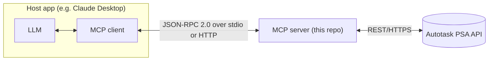
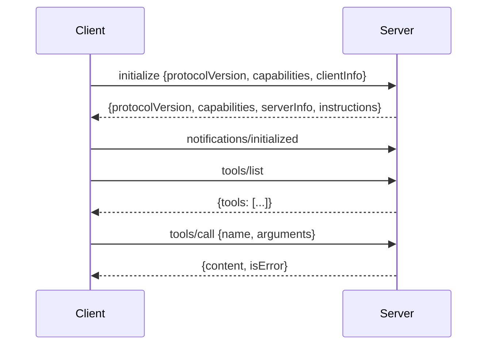
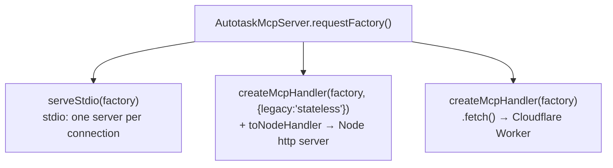
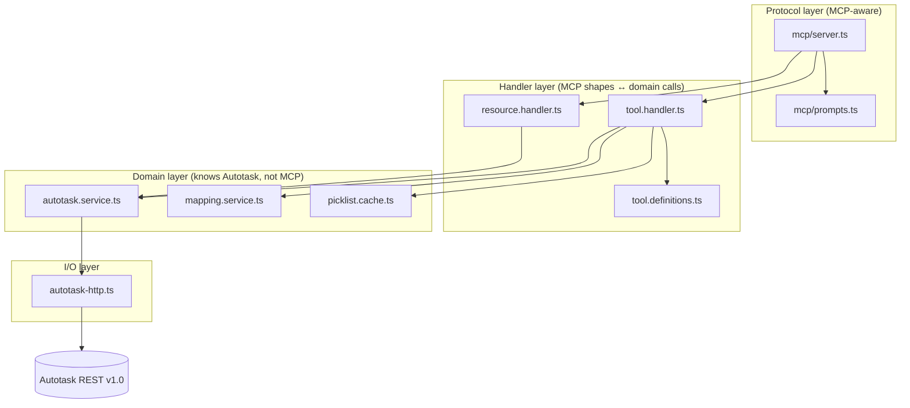
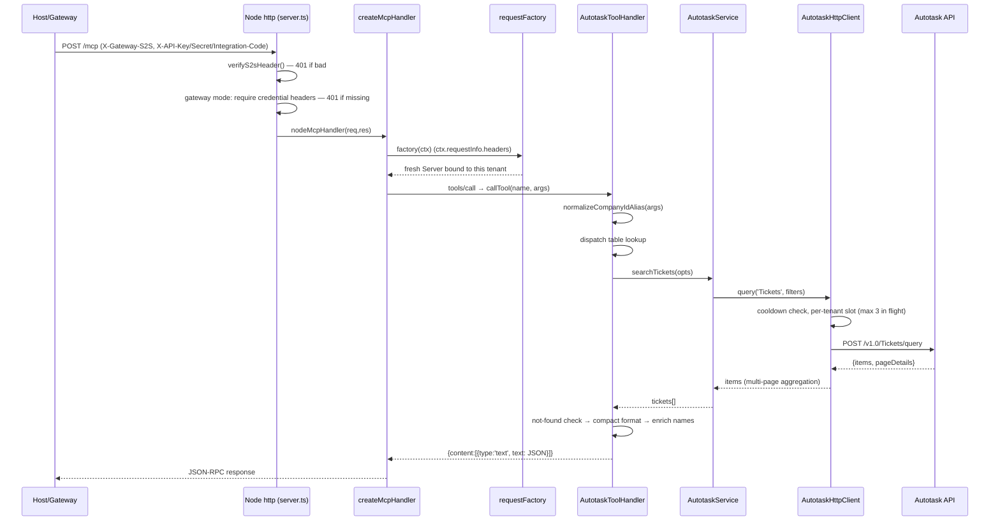
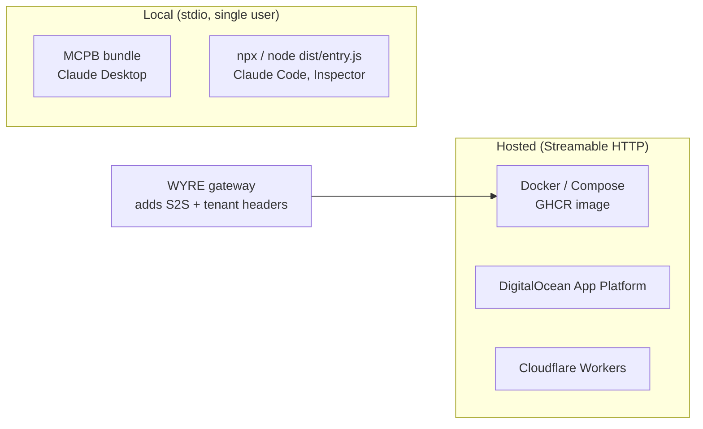

# autotask-mcp: An Onboarding Guide for New MCP Developers

> **Who this is for:** a junior engineer who has never built a Model Context Protocol (MCP) server.
> **What you'll get:** (1) a plain-language intro to MCP and its TypeScript SDK, (2) a tour of how this repo implements it, (3) a feature inventory, and (4) every supported way to run and deploy it.
>
> Written against `main` @ `9d67e25` (package version 2.18.0, Nov 2026). File references are clickable links.

---

## Table of contents

1. [MCP in 10 minutes](#1-mcp-in-10-minutes)
2. [The TypeScript SDK (v2) and how this repo uses it](#2-the-typescript-sdk-v2-and-how-this-repo-uses-it)
3. [Repository map](#3-repository-map)
4. [Request lifecycle: what happens on a tool call](#4-request-lifecycle-what-happens-on-a-tool-call)
5. [Features](#5-features)
6. [Configuration reference](#6-configuration-reference)
7. [Running locally](#7-running-locally)
8. [Deployment options](#8-deployment-options)
9. [Testing and CI/CD](#9-testing-and-cicd)
10. [How to add a new tool (worked example)](#10-how-to-add-a-new-tool-worked-example)
11. [Gotchas and things that look wrong](#11-gotchas-and-things-that-look-wrong)
12. [Glossary](#12-glossary)

---

## 1. MCP in 10 minutes

### 1.1 The problem MCP solves

A large language model (LLM) like Claude can only produce text. To *do* anything (look up a ticket, create a time entry), it needs code that sits between it and the outside system. Before MCP, every AI app invented its own plugin format. **MCP is a standard wire protocol** so that you write the integration once (an *MCP server*) and any MCP-aware app (Claude Desktop, Claude Code, claude.ai connectors, VS Code, etc.) can use it.

### 1.2 The three roles



| Role | What it is | In this project |
|---|---|---|
| **Host** | The app the user talks to. Owns the LLM and the UI. | Claude Desktop, Claude Code, claude.ai, a WYRE gateway |
| **Client** | A connector inside the host. One client per server connection. | Provided by the host; you don't write it |
| **Server** | A program that exposes capabilities to the client. | **This repo** |

### 1.3 The wire format: JSON-RPC 2.0

Every MCP message is a small JSON object. There are three kinds:

```jsonc
// Request (expects a response; has an id)
{ "jsonrpc": "2.0", "id": 1, "method": "tools/list" }

// Response (same id)
{ "jsonrpc": "2.0", "id": 1, "result": { "tools": [ /* ... */ ] } }

// Notification (fire-and-forget; no id)
{ "jsonrpc": "2.0", "method": "notifications/initialized" }
```

Errors come back as `{ "error": { "code": -32603, "message": "..." } }`. Standard codes include `-32601` (method not found) and `-32603` (internal error).

### 1.4 The building blocks ("primitives")

A server can offer three kinds of things:

| Primitive | Who decides to use it | Analogy | Methods |
|---|---|---|---|
| **Tools** | The **model** decides to call it | A function the LLM can invoke | `tools/list`, `tools/call` |
| **Resources** | The **app/user** decides to load it | A read-only file or URL | `resources/list`, `resources/read` |
| **Prompts** | The **user** picks it (e.g. a slash command) | A saved prompt template | `prompts/list`, `prompts/get` |

And a client can offer things back to the server:

| Client feature | What it does | Used here? |
|---|---|---|
| **Elicitation** | Server asks the *user* a structured question mid-call ("pick a date range") | **Yes** (ticket search, picklist selection) |
| **Sampling** | Server asks the client's LLM to generate text | No |
| **Roots** | Client tells server which folders/URIs are in scope | No |

**Rule of thumb:** almost all real work in an MCP server is **tools**. This repo has 110 of them.

### 1.5 A tool, concretely

A tool is advertised with a name, a description (the LLM reads this to decide when to call it), and a **JSON Schema** describing its arguments:

```json
{
  "name": "autotask_search_companies",
  "description": "Search companies by name or status. Max 200/page.",
  "inputSchema": {
    "type": "object",
    "properties": {
      "searchTerm": { "type": "string" },
      "isActive":   { "type": "boolean" },
      "pageSize":   { "type": "number", "minimum": 1, "maximum": 200 }
    },
    "required": []
  },
  "annotations": { "readOnlyHint": true }
}
```

When the model calls it, the server returns a **result**:

```json
{
  "content": [{ "type": "text", "text": "{\"message\":\"Found 3 companies\",\"data\":[...]}" }],
  "isError": false
}
```

Key facts about results:

- `content` is what the **model** sees. It's an array of blocks (`text`, `image`, `resource`...). This repo only returns `text`, usually containing JSON.
- `structuredContent` (optional) is a machine-readable payload for the *host/UI*. Many hosts do **not** pass it to the model, which is why this repo puts the important data in `content` too (see [§11](#11-gotchas-and-things-that-look-wrong)).
- `isError: true` means "the tool ran but failed". This is different from a JSON-RPC `error`, which means "the protocol call itself failed". **Prefer `isError` for business errors**: the LLM can read the message and self-correct.
- `annotations` are *hints* (`readOnlyHint`, `destructiveHint`, `idempotentHint`, `openWorldHint`). Hosts use them to decide whether to ask the user for confirmation. They are not enforced.

### 1.6 The lifecycle

The classic (2025-era) handshake looks like this:



**Capabilities negotiation** is the important idea here. The server says "I support tools, resources, prompts" in its `initialize` response, and the client says what *it* supports (e.g. elicitation). Neither side should use a feature the other didn't declare.

The `instructions` string is free text that many hosts add to the model's system prompt. It's your chance to tell the model how to use your server well.

> **Protocol eras.** This repo targets the `@modelcontextprotocol/server` **v2** SDK, which serves two protocol generations from one codebase: the classic 2025-era `initialize` handshake shown above (called **legacy** in the code) and the newer **2026-07-28** revision (called **modern**). The code comments describe the modern one as a per-request "envelope" format. You mostly don't need to care: the SDK negotiates the era, and the same server code serves both. See [src/mcp/server.ts:5-8](src/mcp/server.ts:5).

### 1.7 Transports: how the bytes travel

| Transport | How it works | When to use | In this repo |
|---|---|---|---|
| **stdio** | Host launches your server as a child process. JSON-RPC goes over stdin/stdout, one message per line. | Local desktop apps; simplest and most common | Default (`MCP_TRANSPORT=stdio`) |
| **Streamable HTTP** | Server listens on a URL (here `/mcp`). Client POSTs JSON-RPC; server replies with JSON or an SSE stream. | Remote/hosted servers, multi-user, gateways | `MCP_TRANSPORT=http`, Docker, Cloudflare Workers |

> ⚠️ **The #1 stdio bug:** with stdio, **stdout is the protocol channel**. A single stray `console.log("hello")` corrupts the stream and the client disconnects. Logs must go to **stderr**. This repo has a dedicated guard for it ([src/entry.ts](src/entry.ts)); see [§2.4](#24-stdio-safety-srcentryts).

---

## 2. The TypeScript SDK (v2) and how this repo uses it

### 2.1 Packages

| Package | Purpose | Where used |
|---|---|---|
| `@modelcontextprotocol/server` | Core server: `Server` class, `createMcpHandler`, error types | [src/mcp/server.ts](src/mcp/server.ts), [src/worker.ts](src/worker.ts) |
| `@modelcontextprotocol/server/stdio` | `serveStdio()` stdio transport | [src/mcp/server.ts:18](src/mcp/server.ts:18) |
| `@modelcontextprotocol/node` | `toNodeHandler()`: adapts the web-standard handler to Node's `http` module | [src/mcp/server.ts:19](src/mcp/server.ts:19) |
| `@modelcontextprotocol/client` *(dev)* | Used by the dual-era smoke test to act as a real client | [scripts/smoke-dual-era.mjs](scripts/smoke-dual-era.mjs) |
| `@modelcontextprotocol/ext-apps` *(dev)* | MCP Apps (interactive UI cards) client library, bundled into the card | [ui/ticket-card.ts](ui/ticket-card.ts) |

> If you've read older MCP tutorials, they import from `@modelcontextprotocol/sdk/server/index.js`. That's the **v1** single-package SDK. This repo is on the v2 split packages. The concepts are the same; the import paths and some names differ (e.g. `ProtocolError` instead of `McpError`, string method names in `setRequestHandler`).

### 2.2 Two ways to write a server, and which one this repo picks

The SDK offers two styles:

**High-level style.** You register each tool with a Zod schema and a callback, and the SDK generates JSON Schema, validates input, and routes calls:

```ts
// Illustrative (NOT how this repo does it)
server.registerTool('add', { inputSchema: { a: z.number(), b: z.number() } },
  async ({ a, b }) => ({ content: [{ type: 'text', text: String(a + b) }] }));
```

**Low-level style (what this repo uses).** You create a `Server`, declare capabilities yourself, and register one handler per protocol **method**:

```ts
// src/mcp/server.ts (simplified)
const server = new Server(
  { name: 'autotask-mcp', version: '2.18.0' },
  { capabilities: { tools: { listChanged: true }, resources: {...}, prompts: {...} },
    instructions: '...' }
);

server.setRequestHandler('tools/list', async () => ({ tools: await toolHandler.listTools() }));
server.setRequestHandler('tools/call', async (req) =>
  toolHandler.callTool(req.params.name, req.params.arguments ?? {}));
```

Why low-level? With 110 tools, the project keeps all schemas as **plain JSON Schema data** in one file ([src/handlers/tool.definitions.ts](src/handlers/tool.definitions.ts)) and dispatches by name through a `Map`. That makes it easy to filter the list (lazy loading), group tools into categories, and expose meta-tools that call other tools.

**The trade-off:** there's **no automatic input validation**. The SDK won't reject `{ "pageSize": "lots" }`; your handler receives whatever the model sent. (`zod` is listed in `package.json` dependencies but isn't imported anywhere in `src/`.) This matters; see [§11](#11-gotchas-and-things-that-look-wrong).

### 2.3 The server factory pattern

The central SDK abstraction here is an **`McpServerFactory`**: a function that builds a fresh `Server` for each connection or request.

```ts
// src/mcp/server.ts:82
public requestFactory(): McpServerFactory {
  return (ctx) => {
    // In gateway mode, read per-tenant credentials from the HTTP headers
    const credentials = isGatewayMode && ctx.requestInfo
      ? parseCredentialsFromHeaders(Object.fromEntries(ctx.requestInfo.headers))
      : undefined;
    return this.createRequestServer(credentials);
  };
}
```

That single factory feeds **all three** entry points:



Because every transport uses the same factory, the tool list can never differ between stdio, Docker, and Workers.

**Why a fresh server per request?** In HTTP **gateway mode** many customers (tenants) share one process. Each request carries its own Autotask credentials in headers, so each request gets its own `AutotaskService` → `AutotaskToolHandler` → `Server`. No mutable state is shared between tenants ([src/mcp/server.ts:151-200](src/mcp/server.ts:151)). This is called **stateless** serving; the `legacy: 'stateless'` option tells the SDK to do the same for 2025-era clients (which means legacy `GET`/`DELETE` session calls get HTTP 405 by design).

### 2.4 stdio safety ([src/entry.ts](src/entry.ts))

`dist/entry.js` is the published binary (`"bin"` in [package.json](package.json)). Before loading anything else it:

1. Redirects `console.log` to stderr (when using stdio), because a dependency printing to stdout would corrupt the protocol stream.
2. Loads a `.env` file with a tiny built-in parser (no dependency that might print).
3. Then **dynamically imports** `./index.js`, so the guard is active before any library code loads.

[src/index.ts](src/index.ts) then loads config, builds the logger, creates `AutotaskMcpServer`, wires SIGINT/SIGTERM for graceful shutdown, and calls `start()`.

### 2.5 Capabilities this server declares

From [src/mcp/server.ts:111-127](src/mcp/server.ts:111):

| Capability | Value | Meaning |
|---|---|---|
| `tools.listChanged` | `true` | Server *may* notify that the tool list changed |
| `resources.listChanged` | `true` | Same, for resources |
| `resources.subscribe` | `false` | No live-update subscriptions on resources |
| `prompts.listChanged` | `false` | Prompt list is static |
| `extensions['io.modelcontextprotocol/ui']` | `{}` | Supports **MCP Apps** (interactive HTML cards, SEP-1865) |
| `instructions` | long markdown | Usage guide for the model ([src/mcp/server.ts:540](src/mcp/server.ts:540)) |

### 2.6 Elicitation (asking the user mid-call)

[src/handlers/tool.handler.ts:289](src/handlers/tool.handler.ts:289) calls `this.mcpServer.elicitInput({ message, requestedSchema })` to show the user a picker (e.g. "which date range?" when a ticket search has no filters). Two good habits to copy:

- It's wrapped in `try/catch` and returns `null` if the client doesn't support elicitation. **Never assume a client feature exists.**
- It has a timeout so non-interactive clients don't hang.

---

## 3. Repository map

```text
autotask-mcp/
├── src/
│   ├── entry.ts               # Published bin. stdio guard + .env loader → index.js
│   ├── index.ts               # main(): config → logger → AutotaskMcpServer.start()
│   ├── worker.ts              # Cloudflare Workers entry (fetch handler)
│   ├── wrapper.js             # Legacy Docker stdio wrapper (spawns index.js)
│   ├── mcp/
│   │   ├── server.ts          # ★ MCP wiring: Server, handlers, stdio + HTTP transports
│   │   ├── prompts.ts         # 4+ prompt templates (prompts/list, prompts/get)
│   │   └── s2s-verify.ts      # HMAC check of X-Gateway-S2S header (HTTP auth)
│   ├── handlers/
│   │   ├── tool.definitions.ts# ★ 110 tool schemas + TOOL_CATEGORIES (data only)
│   │   ├── tool.handler.ts    # ★ listTools / callTool / dispatch table / formatting
│   │   ├── resource.handler.ts# resources/list + resources/read (autotask://, ui://)
│   │   ├── intent-router.ts   # Natural-language → tool+params helper (autotask_router)
│   │   └── card.builder.ts    # Builds the `_card` payload for the MCP Apps ticket UI
│   ├── services/
│   │   ├── autotask.service.ts# ★ Business layer: one method per Autotask operation
│   │   ├── autotask-http.ts   # ★ fetch-based REST client: zones, retries, rate limits
│   │   └── picklist.cache.ts  # Caches picklist (dropdown) values per entity
│   ├── utils/
│   │   ├── config.ts          # Env parsing, header credential parsing, zone detection
│   │   ├── mapping.service.ts # ID → name cache (company/resource names)
│   │   ├── response.formatter.ts # "Compact" search responses to save LLM tokens
│   │   ├── concurrency.ts     # mapWithConcurrency (bounded parallelism)
│   │   ├── logger.ts          # winston logger (to stderr)
│   │   └── vendor-error.ts    # Extract HTTP status from vendor errors
│   ├── types/                 # autotask.ts (entity interfaces), mcp.ts (config types)
│   └── generated/ticket-card-html.ts  # Built UI card, embedded as a string
├── ui/                        # Source for the MCP Apps ticket card (Vite single-file)
├── tests/                     # 38 Jest test files (mocked fetch, no live API needed)
├── scripts/                   # MCPB packing, UI embedding, smoke tests, lint checks
├── docs/                      # Developer guide, migration guide, release docs
├── website/                   # Astro docs site (deployed to GitHub Pages)
├── Dockerfile, docker-compose.yml   # Container build and run
├── wrangler.json              # Cloudflare Workers config
├── .do/deploy.template.yaml   # DigitalOcean App Platform template
├── manifest.json              # MCPB bundle manifest (Claude Desktop one-click install)
├── server.json                # MCP Registry listing
└── .github/workflows/         # test, release, mcp-assert, docs, triage
```

★ = start reading here. A good order: `server.ts` → `tool.handler.ts` (`listTools`, `callTool`, `getDispatchTable`) → one tool in `tool.definitions.ts` → its method in `autotask.service.ts` → `autotask-http.ts`.

### Layering



A useful mental rule: **only `src/mcp/` and `src/handlers/` know about MCP.** The service layer is a plain Autotask client that could be reused in any Node program.

---

## 4. Request lifecycle: what happens on a tool call

Walk through `autotask_search_tickets` arriving over HTTP in gateway mode:



Step by step, in code:

1. **Transport + auth gate:** [src/mcp/server.ts:435-474](src/mcp/server.ts:435). `/health` is open; `/mcp` requires a valid HMAC `X-Gateway-S2S` header and, in gateway mode, the three credential headers.
2. **Factory builds a server:** [src/mcp/server.ts:82](src/mcp/server.ts:82) → `createRequestServer` → `createFreshServer` registers handlers.
3. **`tools/call` handler:** [src/mcp/server.ts:258](src/mcp/server.ts:258) forwards to `toolHandler.callTool`.
4. **`callTool`:** [src/handlers/tool.handler.ts:1786](src/handlers/tool.handler.ts:1786)
   - normalizes `companyId`/`CompanyID` → `companyID`
   - looks up the handler in `getDispatchTable()` (a `Map<toolName, fn>`, [line 952](src/handlers/tool.handler.ts:952))
   - converts empty results into an explicit "not found" error, so the model doesn't invent data
   - formats: compact summaries for search tools, plus `_enhanced` company/resource names
   - catches errors and returns `isError: true` results; rate limits get a typed `error_type: "rate_limited"` envelope telling the model **not to retry**
5. **Service:** [src/services/autotask.service.ts](src/services/autotask.service.ts) builds Autotask query filters (`{ op, field, value }`).
6. **HTTP client:** [src/services/autotask-http.ts:397](src/services/autotask-http.ts:397) handles zone URL resolution, the per-tenant concurrency cap, 429 handling, 401 zone-retry, timeouts, and pagination.

---

## 5. Features

### 5.1 Tools (110)

Defined in [src/handlers/tool.definitions.ts](src/handlers/tool.definitions.ts), grouped by `TOOL_CATEGORIES` ([line 3418](src/handlers/tool.definitions.ts:3418)):

| Category | Examples |
|---|---|
| utility | `test_connection`, `list_queues`, `list_ticket_statuses`, `list_ticket_priorities`, `get_field_info` |
| companies | search/create/update company, site configuration |
| contacts | search/create/update contact |
| tickets | search, get details, create/update, notes, attachments, note attachments, charges, history, checklist items |
| projects | projects, tasks, phases, project notes |
| time_and_billing | time entries, billing items, approval levels, expense reports/items |
| financial | quotes, quote items, opportunities, invoices, contracts (incl. bulk create, services, recurring lines, expiring) |
| products_and_services | products, services, service bundles |
| resources | resources (staff), resource roles |
| configuration_items | configuration items (assets) |
| company_notes | company notes |
| service_calls | service calls, linked tickets, ticket resources |

All tool names are prefixed `autotask_`. Destructive tools carry `annotations: { destructiveHint: true }`, and CI enforces that their descriptions warn about it (`scripts/lint-destructive-warnings.mjs`).

**Special tools:**

| Tool | Purpose |
|---|---|
| `autotask_list_categories` / `autotask_list_category_tools` / `autotask_execute_tool` | **Lazy loading** meta-tools (below) |
| `autotask_router` | Takes a natural-language intent and suggests the right tool and parameters ([intent-router.ts](src/handlers/intent-router.ts)) |
| `autotask_raw_request` | Escape hatch: call any Autotask REST path directly. Guarded by tests in `tests/raw-request-security.test.ts` |

### 5.2 Lazy loading / progressive discovery

110 tool schemas cost a lot of the model's context window. With `LAZY_LOADING=true`, `tools/list` returns only the meta-tools ([tool.handler.ts:894](src/handlers/tool.handler.ts:894)). The model then:

1. calls `autotask_list_categories` to see the groups
2. calls `autotask_list_category_tools({category})` to get those schemas
3. calls `autotask_execute_tool({toolName, arguments})` to run one

This is a common pattern for large MCP servers.

### 5.3 Resources

[src/handlers/resource.handler.ts](src/handlers/resource.handler.ts) exposes:

- `autotask://companies`, `autotask://companies/{id}`
- `autotask://contacts`, `autotask://contacts/{id}`
- `autotask://tickets`, `autotask://tickets/{id}`
- `ui://autotask/ticket-card.html`: the MCP Apps card (MIME `text/html;profile=mcp-app`)

### 5.4 Prompts

[src/mcp/prompts.ts](src/mcp/prompts.ts) provides templates such as `ticket-queue-review`, `weekly-sla-report`, `escalation-summary`, and `new-ticket-draft`. Each has typed `arguments`, and `prompts/get` returns pre-written messages that steer the model through a multi-tool workflow.

### 5.5 MCP Apps: interactive ticket card

`autotask_get_ticket_details` declares `_meta: { 'ui/resourceUri': 'ui://autotask/ticket-card.html' }`. Hosts that support MCP Apps fetch that resource and render it in a sandboxed iframe next to the result.

- Source: [ui/ticket-card.ts](ui/ticket-card.ts) + [ui/index.html](ui/index.html)
- Build: `npm run build:ui` → Vite single-file bundle → [scripts/embed-ui.mjs](scripts/embed-ui.mjs) → `src/generated/ticket-card-html.ts`
- Data: the server attaches a pre-resolved `_card` payload ([card.builder.ts](src/handlers/card.builder.ts)), so the UI doesn't need to look up picklists itself
- The card can call `autotask_create_ticket_note` back through the host ("Add note")
- Branding via `MCP_BRAND_*` env vars

Hosts without MCP Apps support just ignore `_meta` and still get the full text result.

### 5.6 Reliability features (in `autotask-http.ts`)

| Feature | Why it exists |
|---|---|
| **Zone auto-detection** ([config.ts](src/utils/config.ts)) | Each Autotask tenant lives on a different server (`webservicesN`). The server looks it up from the username via Autotask's public `zoneInformation` endpoint and caches it. `AUTOTASK_API_URL` overrides this. |
| **401 zone retry** | If the cached zone is stale, invalidate it and retry once |
| **Per-tenant concurrency cap** (`AUTOTASK_MAX_INFLIGHT`, default 3) | Autotask rejects too many concurrent threads per integration, so extra calls queue instead |
| **Two kinds of 429** | "Thread threshold" 429 → short backoff retry. Hourly "API threshold" 429 → arm a per-tenant **cooldown**: later calls fail fast locally until `Retry-After` passes (capped at 5 min) |
| **Pagination** | Follows `pageDetails.nextPageUrl`, 500 rows per page max |
| **60 s timeout** | Backstop against hung connections |
| **Impersonation** | `ImpersonationResourceId` header so actions are attributed to a specific user |

### 5.7 LLM-friendliness features (in `tool.handler.ts`)

- **ID → name enrichment:** results get an `_enhanced` field with company/resource names, cached per tenant ([mapping.service.ts](src/utils/mapping.service.ts))
- **Compact search responses:** only key fields plus `{ returned, hasMore, page }` ([response.formatter.ts](src/utils/response.formatter.ts))
- **Explicit not-found errors** instead of empty arrays (reduces hallucination)
- **Picklist cache + elicitation:** resolve "High" → priority ID, or ask the user
- **Argument normalization:** accepts `companyId` / `CompanyID` / `companyID`; preserves company ID `0` (WYRE's own root company)

---

## 6. Configuration reference

All configuration is environment variables. See [src/utils/config.ts](src/utils/config.ts) and [.env.example](.env.example).

### Autotask credentials

| Variable | Required | Notes |
|---|---|---|
| `AUTOTASK_USERNAME` | yes* | API user email |
| `AUTOTASK_SECRET` | yes* | API user secret |
| `AUTOTASK_INTEGRATION_CODE` | yes* | Tracking identifier from Autotask admin |
| `AUTOTASK_API_URL` | no | Override zone auto-detection |
| `AUTOTASK_IMPERSONATION_RESOURCE_ID` | no | Act as a specific resource |

\* Not used in gateway mode, where they arrive as headers. The server **starts without credentials** and returns tool errors, so clients see a clear message instead of a silent disconnect.

### Server / transport

| Variable | Default | Notes |
|---|---|---|
| `MCP_TRANSPORT` | `stdio` | `stdio` or `http` |
| `MCP_HTTP_PORT` | `8080` | |
| `MCP_HTTP_HOST` | `0.0.0.0` | Forced to `127.0.0.1` without a usable S2S secret |
| `AUTH_MODE` | `env` | `env` = credentials from env vars; `gateway` = from request headers |
| `CONDUIT_S2S_SECRET` | none | **Required for HTTP.** HMAC key for `X-Gateway-S2S`. Empty or placeholder values make the server exit |
| `MCP_ALLOW_INSECURE_DEV` | none | `1` = skip S2S check, bind loopback only. **Local dev only** |
| `LAZY_LOADING` | `false` | Expose only the meta-tools |
| `LOG_LEVEL` / `LOG_FORMAT` | `info` / `simple` | `error\|warn\|info\|debug`, `json\|simple` |
| `AUTOTASK_MAX_INFLIGHT` | `3` | Per-tenant concurrent REST calls |
| `AUTOTASK_ENHANCE_CONCURRENCY` | `3` | Parallelism for name enrichment |
| `MCP_BRAND_*` | none | Ticket card branding |

### Gateway-mode request headers

| Header | Maps to |
|---|---|
| `X-Gateway-S2S: t=<unix>,v1=<hex>` | HMAC-SHA256 of `t=<unix>` with `CONDUIT_S2S_SECRET`, ±300 s |
| `X-API-Key` | username |
| `X-API-Secret` | secret |
| `X-Integration-Code` | integration code |
| `X-API-Url` *(optional)* | zone URL |
| `X-Impersonation-Resource-Id` *(optional)* | impersonation |

---

## 7. Running locally

Prerequisites: Node ≥ 20 (the Dockerfile uses Node 26), an Autotask API user.

```bash
npm ci
```

```bash
cp .env.example .env
```

Fill in the three `AUTOTASK_*` values in `.env`, then:

```bash
npm run build
```

### 7.1 Talk to it with the MCP Inspector (recommended first step)

The [MCP Inspector](https://github.com/modelcontextprotocol/inspector) is a browser UI that acts as an MCP client. Use it to list tools and call them by hand:

```bash
npx @modelcontextprotocol/inspector node dist/entry.js
```

### 7.2 Use it from Claude Code

```bash
claude mcp add autotask-mcp -e AUTOTASK_USERNAME=you@co.com -e AUTOTASK_SECRET=xxx -e AUTOTASK_INTEGRATION_CODE=yyy -- node /absolute/path/to/autotask-mcp/dist/entry.js
```

### 7.3 Use it from Claude Desktop (manual JSON)

In `claude_desktop_config.json`:

```json
{
  "mcpServers": {
    "autotask": {
      "command": "node",
      "args": ["C:/Dev/projects/shi-work-related/autotask-mcp/dist/entry.js"],
      "env": {
        "AUTOTASK_USERNAME": "you@company.com",
        "AUTOTASK_SECRET": "…",
        "AUTOTASK_INTEGRATION_CODE": "…"
      }
    }
  }
}
```

### 7.4 Run the HTTP transport locally

```bash
MCP_TRANSPORT=http MCP_ALLOW_INSECURE_DEV=1 node dist/entry.js
```

```bash
curl http://127.0.0.1:8080/health
```

### 7.5 Dev loop

- `npm run dev` runs `tsx src/index.ts` (no build step)
- `npm test`, `npm run lint`
- `node scripts/smoke-dual-era.mjs` after a build: proves both legacy and modern clients see the same tools over HTTP

---

## 8. Deployment options



### 8.1 MCPB bundle (Claude Desktop one-click)

- [manifest.json](manifest.json) describes the bundle: entry point `dist/entry.js`, stdio, and a `user_config` form that prompts for the three credentials (the secret is marked `sensitive`).
- Build it with `npm run pack:mcpb` ([scripts/pack-mcpb.js](scripts/pack-mcpb.js)). It builds, stages production deps only, and runs `mcpb pack`.
- Released `.mcpb` files are attached to GitHub Releases. Users double-click to install.

### 8.2 `npx` from GitHub

```bash
claude mcp add autotask-mcp -e AUTOTASK_USERNAME=… -e AUTOTASK_SECRET=… -e AUTOTASK_INTEGRATION_CODE=… -- npx -y github:WYRE-AI/autotask-mcp
```

`npm` runs the `prepare` script (`npm run build`) on install, then the `bin` points at `dist/entry.js`.

### 8.3 Docker

[Dockerfile](Dockerfile): a multi-stage build.

- **builder:** `npm ci`, patch `package.json` version from the `VERSION` build arg, `npm run build`
- **production:** Node 26 Alpine, non-root user `autotask`, dev deps pruned, the npm CLI removed (smaller attack surface), `HEALTHCHECK` on `/health`
- Defaults: `MCP_TRANSPORT=http`, port 8080, `AUTH_MODE=env`, `CMD node dist/index.js`

```bash
docker build -t autotask-mcp .
```

```bash
docker run --rm -p 127.0.0.1:8080:8080 -e CONDUIT_S2S_SECRET=<real-secret> -e AUTOTASK_USERNAME=… -e AUTOTASK_SECRET=… -e AUTOTASK_INTEGRATION_CODE=… autotask-mcp
```

The container **refuses to start** without a real `CONDUIT_S2S_SECRET`. Every `/mcp` call then needs a signed `X-Gateway-S2S` header (README "X-Gateway-S2S signing" has a `curl` + `openssl` example).

### 8.4 Docker Compose

[docker-compose.yml](docker-compose.yml):

- `autotask-mcp`: **gateway mode**, port bound to `127.0.0.1:8080`, needs `CONDUIT_S2S_SECRET` in `.env`, 256 MB memory limit. Deliberately has **no** Autotask credentials; they come per request.
- `autotask-mcp-dev` (profile `dev`): runs `npm run dev` with source mounted, credentials from `.env`.

```bash
docker compose up -d
```

```bash
docker compose --profile dev up autotask-mcp-dev
```

### 8.5 DigitalOcean App Platform

[.do/deploy.template.yaml](.do/deploy.template.yaml) builds from the Dockerfile on push to `main` (`basic-xxs` instance, port 8080). Secrets: `AUTOTASK_*` and `CONDUIT_S2S_SECRET`. The README has a one-click "Deploy to DO" button.

### 8.6 Cloudflare Workers

- [wrangler.json](wrangler.json): `main: src/worker.ts`, `nodejs_compat` flag
- [src/worker.ts](src/worker.ts) uses the SDK's web-standard `createMcpHandler(...).fetch(request)` and the **same factory**. It works on Workers because the HTTP client only uses global `fetch`.
- Set secrets with `wrangler secret put AUTOTASK_USERNAME` (and the others), then:

```bash
npx wrangler deploy
```

> ⚠️ The Worker does **not** check `X-Gateway-S2S`, unlike the Node HTTP server. In `AUTH_MODE=env`, anyone who knows the URL can call your tools with your credentials. Use gateway mode or put it behind Cloudflare Access. See [§11](#11-gotchas-and-things-that-look-wrong).

### 8.7 MCP Registry

[server.json](server.json) lists the server as `io.github.WYRE-AI/autotask-mcp`, pointing at the OCI image `ghcr.io/wyre-ai/autotask-mcp`. The Dockerfile's `io.modelcontextprotocol.server.name` label must match it. The release pipeline fills in the `0.0.0` placeholder version.

### 8.8 Release pipeline

- **semantic-release** ([.releaserc.json](.releaserc.json)): Conventional Commit messages (`fix:`, `feat:`, `feat!:`) decide the version bump, generate `CHANGELOG.md`, and create a GitHub Release.
- [.github/workflows/release.yml](.github/workflows/release.yml) calls a shared WYRE reusable workflow (`mcp-server-release.yml`) that builds and publishes the image/bundle.
- Because branch protection drops semantic-release's push-back to `main`, `package.json` on `main` can lag. The real version is injected at Docker build time via `--build-arg VERSION`.

---

## 9. Testing and CI/CD

### Tests

- **Jest + ts-jest**, config in [jest.config.js](jest.config.js), 38 files in [tests/](tests/)
- Most tests **mock `fetch`** and assert on the request actually sent to Autotask (method, path, body). Per the project learnings in [CLAUDE.md](CLAUDE.md), asserting only on return values can miss silently-dropped filters.
- Examples worth reading:
  - [tests/http-s2s-auth.test.ts](tests/http-s2s-auth.test.ts): HTTP auth gate
  - [tests/lazy-loading.test.ts](tests/lazy-loading.test.ts): meta-tools
  - [tests/rate-limit-cooldown-gate.test.ts](tests/rate-limit-cooldown-gate.test.ts): 429 handling
  - [tests/mcp-apps.test.ts](tests/mcp-apps.test.ts): UI resource + `_meta`
  - [tests/worker.test.ts](tests/worker.test.ts): Workers entry
- `npm test` runs `npm run build` first (`pretest`)

### Workflows ([.github/workflows/](.github/workflows/))

| Workflow | Does |
|---|---|
| `test.yml` | lint, destructive-warning lint, build, test; Docker build per platform; coverage → Codecov |
| `mcp-assert.yml` | Shared WYRE workflow that checks MCP protocol conformance |
| `release.yml` | semantic-release + image/bundle publish |
| `deploy-docs.yml` | Builds the Astro `website/` and deploys it to GitHub Pages |
| `claude.yml`, `pr-triage.yml`, `add-to-project.yml` | Automation / triage |

---

## 10. How to add a new tool (worked example)

Say you want `autotask_get_contact`.

1. **Check it doesn't exist.** Search [tool.definitions.ts](src/handlers/tool.definitions.ts). The project learnings note that issues sometimes ask for tools that already exist.
2. **Add a service method** in [autotask.service.ts](src/services/autotask.service.ts):
   ```ts
   async getContact(id: number): Promise<AutotaskContact | null> {
     const http = await this.ensureClient();
     return http.get<AutotaskContact>('Contacts', id);
   }
   ```
   (Neighbouring methods like `getCompany` also wrap this in `try/catch` with debug logging.) If the entity has a **parent** in Autotask's docs, use the `child*` helpers (`/Parent/{id}/Child`).
3. **Add the schema** to `TOOL_DEFINITIONS`:
   ```ts
   {
     name: 'autotask_get_contact',
     description: 'Get a contact by ID',
     inputSchema: { type: 'object', properties: { id: { type: 'number' } }, required: ['id'] },
     annotations: { readOnlyHint: true }
   },
   ```
4. **Add it to `TOOL_CATEGORIES`** (`contacts`). Nothing enforces this, and it has drifted before. Without it, the tool is invisible in lazy-loading mode.
5. **Add a dispatch entry** in `getDispatchTable()`:
   ```ts
   ['autotask_get_contact', async (a) => {
     const r = await s.getContact(a.id);
     return { result: r, message: `Contact ${a.id}` };
   }],
   ```
6. **Validate arguments yourself** if they matter. There's no schema validation layer.
7. **Write a test** that mocks `fetch` and asserts the URL/method sent.
8. **Check the router** (`routeIntent`) if natural-language routing should reach it.
9. Commit with a Conventional Commit (`feat: add autotask_get_contact`) so semantic-release bumps the minor version.

Because `tools.listChanged` is declared but the list is static at runtime, clients pick up new tools on reconnect.

---

## 11. Gotchas and things that look wrong

Things a newcomer will trip over, plus a few inconsistencies I found while exploring. The inconsistencies are worth a ticket each.

**Design gotchas (intentional, learn them):**

1. **No input validation.** The JSON Schema is only advertised; whatever the model sends reaches your handler, including parameters removed from the schema. Guard explicitly.
2. **Bad Autotask filter operators are silently dropped.** `{ op: 'ne' }` (the real operator is `noteq`) returns *everything*. Bad field names, by contrast, return HTTP 500. Test the request body, not just the result.
3. **`searchTerm` on ticket search is a ticket-number prefix**, not free text. Company names go to `companyID`.
4. **Company ID `0` is real** (WYRE's root company). Use `!== undefined`, never truthiness.
5. **`content` vs `structuredContent`.** Models usually only see `content`. Put everything the model needs there ([tool.handler.ts](src/handlers/tool.handler.ts) `formatTicketDetailsText`).
6. **Never add a 404 → fallback on writes** in `childCreate()`. A 404 is ambiguous and could create mis-scoped records.

**Inconsistencies I found (not fixed, just reported):**

| # | Where | What |
|---|---|---|
| A | [src/worker.ts](src/worker.ts) | Cloudflare Worker has no `X-Gateway-S2S` check, while Node HTTP refuses to start without one. In `AUTH_MODE=env` the Worker URL is effectively unauthenticated. |
| B | [src/mcp/server.ts:562](src/mcp/server.ts:562) | Server `instructions` say "39 tools total"; there are 110. The model is told an outdated count. |
| C | [src/mcp/server.ts:555](src/mcp/server.ts:555), [tool.handler.ts:896](src/handlers/tool.handler.ts:896) | Docs/comments say lazy loading exposes **3** meta-tools; the code exposes **4** (`autotask_router` too). |
| D | `npm run dev` | Runs `src/index.ts` directly, skipping the stdio guard in `entry.ts`. Fine for HTTP; a stray stdout write could break stdio in dev. |
| E | [manifest.json](manifest.json) | `version: 2.2.3` and `license: MIT`, while `package.json` says 2.18.0 and Apache-2.0. (The pack script may patch the version; the license mismatch looks real.) |
| F | README "Health Check Response" | Shows `"transport": "http"`; the code emits `"mcpTransport"` plus `version`. |
| G | README One-Click note vs [package.json](package.json)/[Dockerfile](Dockerfile) | README says `autotask-node` is a public git dependency needing no token. It's now a dev-only `npm:@wyre-technology/autotask-node` alias, and the Dockerfile still writes a GitHub Packages `.npmrc` with `GITHUB_TOKEN`. The runtime no longer uses that SDK. |
| H | [package.json](package.json) | `zod` is a runtime dependency but isn't imported in `src/`. |
| I | [server.json](server.json) | Declares the OCI package with `stdio` transport, but the image defaults to `MCP_TRANSPORT=http`. Registry users must override the env var. |

---

## 12. Glossary

| Term | Meaning |
|---|---|
| **MCP** | Model Context Protocol: a JSON-RPC standard for connecting LLM apps to tools and data |
| **Host / Client / Server** | The app / its per-connection connector / your integration program |
| **Tool** | Model-invoked function with a JSON Schema input |
| **Resource** | App-loaded, URI-addressed read-only content |
| **Prompt** | User-selected message template |
| **Elicitation** | Server asks the user for structured input through the client |
| **Capabilities** | Feature flags exchanged at initialization |
| **stdio / Streamable HTTP** | The two standard transports |
| **Legacy / modern era** | 2025-era `initialize` handshake vs the 2026-07-28 protocol revision; the v2 SDK serves both |
| **Stateless serving** | A fresh `Server` per HTTP request; nothing shared between requests |
| **Gateway mode** | Multi-tenant HTTP; credentials arrive per request as headers |
| **S2S** | Service-to-service HMAC header proving the request came from the trusted gateway |
| **MCP Apps (SEP-1865)** | Extension letting a tool point to a `ui://` HTML resource the host renders |
| **MCPB** | MCP Bundle: a `.mcpb` zip + `manifest.json` for one-click desktop install |
| **Zone** | The Autotask datacenter URL (`webservicesN.autotask.net`) a tenant lives on |
| **Picklist** | Autotask's enumerated dropdown values (status, priority, queue IDs) |
| **Lazy loading** | Exposing a few meta-tools instead of all 110 to save context |

### Further reading

- MCP specification and concepts: <https://modelcontextprotocol.io>
- TypeScript SDK: <https://github.com/modelcontextprotocol/typescript-sdk>
- MCP Inspector: <https://github.com/modelcontextprotocol/inspector>
- In-repo: [docs/DEVELOPER_GUIDE_MCP_AUTOTASK.md](docs/DEVELOPER_GUIDE_MCP_AUTOTASK.md), [docs/MIGRATION_GUIDE.md](docs/MIGRATION_GUIDE.md), [DOCKER_USAGE.md](DOCKER_USAGE.md), [CLAUDE.md](CLAUDE.md) (project learnings)
